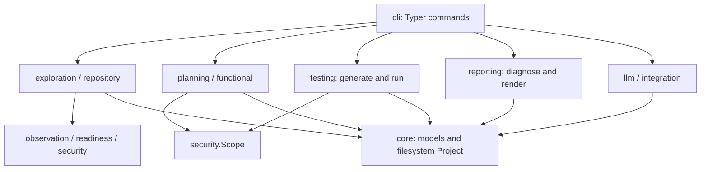
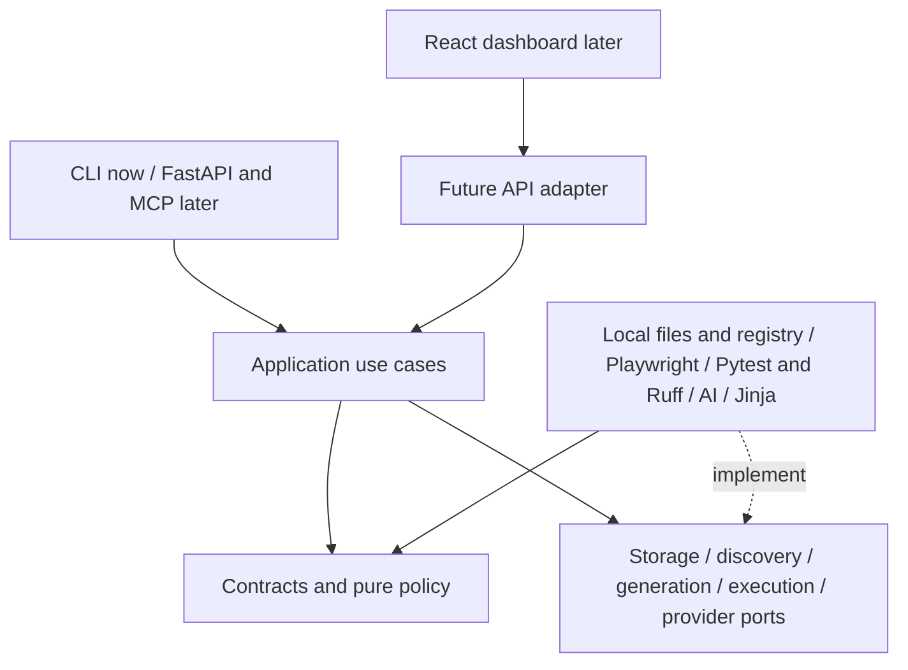

# AutoQA V0.3 architecture plan

Status: proposed; documentation only. Assessment covers the current `src/autoqa` package, its configuration, tests and verification documentation. Package metadata remains 0.2.0; the working tree also contains the targeted compatibility/readiness changes documented for V0.2.1. This plan does not authorize external execution or API permissions.

## 1. Existing architecture

AutoQA is a synchronous modular monolith. Retain that deployment model while separating reusable engine operations from interface and infrastructure concerns.

The graph summarizes direct and orchestration dependencies; it is not a complete import graph. `testing` also imports planning signatures; `functional` is loaded by planning/generation. `core` is the common dependency and combines Pydantic models, YAML/JSON persistence, project selection, audit logging and SQLite registration.

| Component | Current responsibility and coupling |
| --- | --- |
| [CLI](../src/autoqa/cli.py) | Commands, Rich output and exit codes, plus authorization checks, mode/config changes, repository/UI ordering and optional AI invocation. Library calls do not automatically inherit CLI authorization checks. |
| [Core](../src/autoqa/core.py) | `Config`, discovery/evidence/case models and concrete `Project`. Project construction loads configuration; methods read/write fixed artifact paths. Registry and active-project selection depend on local directories. |
| [Exploration](../src/autoqa/exploration.py), [observation](../src/autoqa/observation.py), [readiness](../src/autoqa/readiness.py) | Browser lifecycle, bounded traversal, semantic controls, locator counts, screenshots, workflow inference and readiness evidence. Exploration also saves configuration, discovery and audit artifacts. Readiness uses observable states and bounded mutation quietness; completeness remains unverified. |
| [Repository analysis](../src/autoqa/repository.py) | Bounded static source inspection, source-only discovery and hybrid correlation; directly persists findings and configuration. Does not execute source. |
| [Planning](../src/autoqa/planning.py), [functional contracts](../src/autoqa/functional.py) | Evidence-to-case rules, requirement validation, approval signatures and deterministic templates. Planning also imports files, performs scope/DNS checks and writes JSON/Markdown. Functional contracts already separate actions/assertions from arbitrary Python. |
| [Testing](../src/autoqa/testing.py) | Generation, AST/Ruff validation, manifest integrity, collection, subprocess execution and JUnit parsing. These are separate responsibilities inside one module. Generated fixtures import AutoQA and depend on the project directory layout. |
| [Reporting](../src/autoqa/reporting.py) | Error classification, run-snapshot projection, evidence lookup and HTML/JSON rendering. Reports invoke diagnosis, which writes a diagnosis artifact. Run/report payloads are largely dictionaries. |
| [Security](../src/autoqa/security.py) | URL/resource policy, DNS validation/pinning, request counters/throttling, audit decisions and browser/CDP interception are combined in `Scope`. Policy enforcement is shared by discovery and generated execution. |
| [AI](../src/autoqa/llm.py), [integration](../src/autoqa/integration.py) | AI has a provider protocol but selects configuration/environment and writes recommendations directly. Integration generates a local GitHub workflow using the current working directory and project-relative paths. |

Existing data flow is discovery → reviewed cases → approved generation → verified manifest → collected/executed tests → diagnosis/report. SQLite stores the project registry, not execution history. JSON and file artifacts are the durable record. There is no first-class TestSuite, TestStep, TestRun or StepResult model: cases use textual steps plus optional behavior contracts, while runs use dictionaries and test-level JUnit results.

## 2. Target architecture

Keep the existing Python package and dependencies. Introduce boundaries only when moving implemented behavior; do not create empty packages. Preserve existing import paths through forwarding facades during migration.

Proposed logical ownership, not scaffolding to create now:

- **Domain:** versioned contracts, evidence provenance, review transitions, scenario signatures and pure planning/validation rules. No Typer, filesystem, browser, subprocess, network or provider SDK access.
- **Application:** initialize, discover, plan, approve/reject, generate, run, diagnose and report use cases. Explicit project identity, authorization context, deadline and dependencies replace implicit current-directory selection. Commands return typed results; interfaces format them.
- **Ports:** narrow protocols for project/artifact storage, browser/static discovery, generation/validation, execution and advisory AI. Add only ports needed by extracted use cases. Inject time/IDs where reproducibility requires them.
- **Adapters:** existing YAML/JSON/SQLite layout; Playwright observation/readiness and network enforcement; trusted templates, Ruff and Pytest; Jinja rendering; optional provider SDK; CLI project selection and Rich presentation.
- **Composition root:** builds the existing local adapters once and supplies application services. Future interfaces call the same services. Authorization, approvals and safety checks must therefore execute below every interface.

Separate immutable scope configuration/decision rules from mutable browser-session enforcement without weakening either. DNS resolution, redirect interception, counters and pinned browser configuration stay at the infrastructure boundary. Deny by default; retain domain/origin restrictions, explicit API-resource approval, credential restrictions, write blocking, request/page/depth/time limits and bounded readiness. Never treat a UI readiness observation as proof of expected business behavior.

Keep single-writer operation per project initially. A future service adapter requires an explicit project lock, revision checks and cancellation/timeout handling before concurrent writes are enabled. A web request or MCP call must not create a second independent policy path. React receives DTOs and authorized evidence references rather than local filesystem paths. Scheduling, persistent job queues and tenant authentication remain separate design decisions.

## 3. Shared data contracts

Use Pydantic v2 with JSON-compatible fields and explicit string enums. Introduce schema versions on new envelopes; keep legacy readers rather than inserting fields into old files automatically. IDs are persisted opaque strings, timestamps UTC, artifact references project-relative and validated by storage. Preserve existing case IDs and approval signatures. New fields must not silently change the signed legacy representation.

| Contract | Required meaning and proposed fields | Legacy mapping |
| --- | --- | --- |
| **Project** | `id`, `name`, `revision`, `config`, scope-policy revision, created/updated timestamps. Configuration contains target/mode/limits and references, never credentials. Workspace location belongs to the adapter. | Existing `core.Project` remains the filesystem facade; its config maps to a new data contract with a distinct Python name until callers migrate. Assign/persist project identity only in an explicit migration. |
| **TestSuite** | `id`, `project_id`, `revision`, case IDs/revisions, discovery/requirement evidence references, generation status, manifest reference and generator/runtime versions. One suite revision describes one reviewed input set. | Project matrix plus manifest provide a legacy suite projection; label it derived. Do not invent historical suite revisions or rewrite artifacts on read. |
| **TestCase** | Existing ID, suite membership/revision, feature/title/type/priority, preconditions, data references, ordered steps, expected assertions, feasibility with reason, evidence references, review record. Review records bind decision, actor/source and timestamp to the scenario signature. | Retain current fields and pending/approved/rejected behavior through conversion. Existing approvals have legacy provenance; do not fabricate actors/timestamps. Changed signed behavior requires review. |
| **TestStep** | `id`, ordinal, discriminated action/assertion/observation kind, typed parameters, target/locator reference, expected outcome, evidence references and execution support status. Values remain data; actions/assertions remain allowlisted. | Map validated functional actions/assertions explicitly. Preserve textual legacy steps as descriptive, non-executable steps; never infer executable semantics from prose. Existing supported heading/link templates need explicit mappings. |
| **TestRun** | `id`, project/suite revision, immutable case/config/policy snapshots, runtime/generator versions, start/end times, process/collection outcome, test results, evidence references and artifact manifest. Distinguish run failure from a failed assertion. | Parse current run dictionaries/JUnit without changing meanings. Preserve PASS/FAIL/ERROR/SKIPPED/NOT_EXECUTED distinctions. A report before execution is a report context, not a fabricated run. |
| **StepResult** | Run/case/step IDs, attempt, status, timestamps/duration where measured, actual observation/error and evidence references. Optional test-level result remains necessary for setup, collection and teardown failures. | Existing JUnit records have no step instrumentation. Represent step detail as unavailable (`NOT_RECORDED`), distinct from a step known not to execute. Do not distribute test duration or infer successful steps. |
| **Evidence** | `id`, provenance category, producer/version, observed timestamp, project/run/case/step links where applicable, sanitized source reference, description, artifact reference/media type/digest where available and sensitivity classification. | Unify existing EvidenceReference, screenshot/trace/log references and readiness observations through adapters. Preserve OBSERVED/SOURCE/VERIFIED_REQUIREMENT/INFERRED/UNKNOWN distinctions and unknown metadata. |

Discovery, locator candidates and BehaviorContract remain supporting contracts, not discarded intermediate dictionaries. Stable persisted IDs should replace position-dependent element identities for new discoveries only; old evidence IDs must remain resolvable. Requirement evidence and observations remain separate. Approval never follows automatically from discovery, AI advice, imported requirements or schema conversion.

Keep planning review status, generation status, execution status and evidence confidence independent. Define conversion errors explicitly: reject unsupported schema versions; preserve original artifacts; never silently drop unknown behavior. A versioned reader normalizes old data in memory, and a separately requested writer migration creates a backup and validates round trips.

## 4. Minimum safe migration order and targeted checks

Each stage is separately reviewable. Move one responsibility behind a facade, compare behavior, then switch callers. No dependency updates or interface implementations are prerequisites.

| Stage | Change when implementation is authorized | Targeted verification and exit criterion |
| --- | --- | --- |
| **0. Characterize** | Freeze representative legacy inputs/outputs and enumerate CLI/import/artifact contracts. Capture current signatures and generated-suite expectations. | Extend [core tests](../tests/test_core.py), [pipeline tests](../tests/test_pipeline.py) and [contract tests](../tests/test_contracts.py) with CLI option/exit-code, project-selection, legacy JSON and artifact-path fixtures. Baseline actual behavior; no mass snapshot regeneration. |
| **1. Contracts/readers** | Add real versioned models and explicit legacy converters, initially behind existing functions. | Round-trip representative V0.1/V0.2 inputs; reject future versions; distinguish absent step results and no execution; retain approval signatures, evidence categories and run snapshots. Reading must not write. |
| **2. Storage boundary** | Extract local repository/artifact access from `core.Project`; retain its public facade and exact layout. Keep registry/project selection in local adapters. | Existing initialization/isolation/config tests plus traversal/link rejection, atomic-write failure, missing/corrupt artifact behavior and byte-preservation on reads. Verify no implicit artifact migration. |
| **3. Diagnostics/report projection** | Extract pure classification and report view construction; keep Jinja/JSON and writes in adapters/application orchestration. Preserve CLI diagnosis artifacts explicitly. | Existing escaping, snapshot-after-replan and pre-execution report tests; compare legacy metrics/statuses/evidence links. Check report side effects match the CLI contract and missing evidence is reported truthfully. |
| **4. Planning/review use cases** | Extract pure case construction/contract validation; application handles loading, scope validation and persistence. Move review/generation authorization checks below interfaces. | Existing approval persistence, drift, unknown-ID and contract-safety tests; compare case IDs/signatures and markdown. Direct service calls must reject the same unauthorized operations as CLI calls; AI remains advisory. |
| **5. Discovery orchestration** | Introduce browser/static discovery adapters and shared authorized discovery use case. Keep security enforcement and readiness behavior intact. | Existing bounded exploration, repository/source/hybrid and [external compatibility tests](../tests/test_external_compatibility.py), using local fixtures only: allowed/denied resources, DNS, redirects, writes, credentials, budgets and readiness timeout. Compare provenance and artifacts. No external run or permission expansion. |
| **6. Generation/execution** | Separate deterministic rendering, validation, manifest checks, subprocess execution and result ingestion. Introduce typed runs through converters. Step instrumentation is a later explicit change. | Existing integrity/approval binding, modified-suite refusal, collection/JUnit mapping, environment restrictions and real local browser slice. Preserve generated import/runtime requirements and manifest semantics; verify collection failures never become passes. |
| **7. Shared engine entry point** | Finish composition and reduce CLI to argument translation/output. Keep local integration/AI adapters behind the same application boundary. | Invoke identical operations via CLI and an in-process test adapter; compare artifacts, errors and authorization decisions. No FastAPI/MCP dependency or server required. Run the owned independent acceptance workflow once as the migration release gate. |

Keep the independent local acceptance invariant: **9 healthy passes → 2 intentional regressions detected → 9 restored passes**. Historical evidence is documented in [V0.2 delivery](./v02-delivery.md) and [verification](./verification.md); it is not a fresh V0.3 test result. Use only targeted tests during each implementation stage. The acceptance workflow is a final local gate, not permission to execute external tests.

## 5. Compatibility risks and controls

| Risk | Required control |
| --- | --- |
| New model defaults/schema fields change case hashes and invalidate or accidentally preserve approval. | Version signature algorithms; retain legacy projections and golden signatures; new behavior/evidence revisions require review. |
| Moving `core.Project`, models or fixture imports breaks client automation. | Retain `autoqa` entry point, existing commands/options, Python import facades and generated fixture support until an explicit deprecation. Preserve run exit codes. |
| New suite/element identity breaks references. | Maintain old IDs and mappings; assign new IDs at explicit creation/migration boundaries. Never reinterpret old evidence. |
| Path/cwd/environment changes select another client project or break workflow generation. | Resolve CLI context once; pass explicit workspace/project IDs; test active selection, relative paths, `AUTOQA_BASE_URL` and integration cwd behavior. |
| Report normalization mixes historical snapshots with current plans. | Prefer run snapshots; preserve documented legacy fallbacks with provenance/availability indicators. Do not silently upgrade old metrics to newly verified facts. |
| Policy extraction allows bypass from API/MCP/library callers. | Centralize authorization in use cases and enforcement in adapters; retain deny-by-default tests for every execution route. No permission expansion through migration. |
| New concurrent interfaces corrupt latest-run/config/audit or mix evidence. | Keep one writer per project; require locks and revision checks before concurrency. Atomic replacement alone is insufficient. Preserve immutable run directories. |
| Serialization exposes credentials or absolute client paths. | Separate runtime secret access from stored contracts; validate artifact references and sanitize evidence/errors at adapter boundaries. Retain current authentication restrictions. |

Artifact compatibility includes configuration, discovery JSON/Markdown, behavior contracts, case JSON/Markdown, generated Python/conftest/manifest, per-run logs/JUnit/traces/screenshots/result JSON, latest-run, diagnosis, HTML/JSON reports, registry selection and audit logs. Existing projects must remain usable without automatic rewriting. Standalone suite export, authenticated workflows, arbitrary executable AI/client code, server scheduling and multi-client authorization require separate decisions.

## 6. Acceptance criteria and current delivery

- The same installed `autoqa` commands and approved project artifacts work throughout migration; no mandatory framework, dependency, package rename or artifact conversion is introduced.
- Domain contracts and pure rules import without CLI/browser/provider/storage side effects. Engine operations can be exercised with in-memory adapters while the CLI uses existing local adapters.
- Every entry point enforces the same authorization, approval and network controls. Unknown behavior stays review-required; readiness never substitutes for a behavior contract.
- Generated suite integrity, historical report truthfulness, project isolation and the local 9/2/9 acceptance invariant remain intact.
- Each stage passes its targeted checks before the next begins. Future API/MCP/dashboard adapters are deferred until these boundaries are proven.

This assessment changed only this plan. No production code, dependencies, project artifacts or interfaces were changed; no tests, builds or external scenarios were executed. Implementation remains pending a separate instruction.
