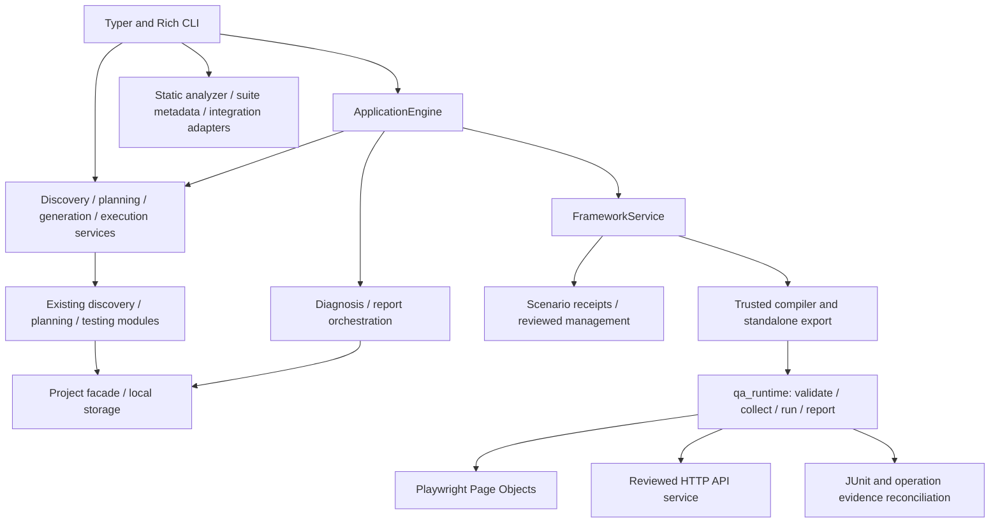

# Architecture

## Current V0.6.0 map

This section describes the implemented local Python CLI at stable `v0.6.0`
(`bbd54ad0821cb6962c09d8a1149a0f40b936764b`). GitHub refs and active PRs are
observations that the Lead must refresh; use the permanent project-state handoff
for publication evidence. The V0.1/V0.2 architecture text is retained below as
historical evidence, not the current complete module map.

AutoQA is a supervised professional QA Automation Engineering tool for authorized
applications and local repositories. Its runtime remains a synchronous modular
monolith. Repository engineering agents collaborate on this codebase; they are
not autonomous workers added to the AutoQA product. There is no SaaS, tenant
service, web server or new orchestration dependency in this foundation.

The implemented stack is Python 3.14 (`>=3.14,<3.15`), uv, Typer/Rich, Pydantic,
Playwright/Pytest, Jinja2, YAML, a local SQLite project registry and local JSON
artifacts. The optional OpenAI provider supplies review-only recommendations.
See [package metadata](../pyproject.toml) and [security boundaries](security.md).

### Application and adapter dependencies

This is an orchestration map, not an exhaustive import graph. The contracts and
security modules below are shared dependencies. Services still delegate to existing
modules; this is not a completed ports-and-adapters extraction or an injected
infrastructure framework.

| Boundary | Actual modules and responsibilities |
| --- | --- |
| Presentation and local commands | [cli.py](../src/autoqa/cli.py) converts Typer arguments, selects projects, constructs operation intent, presents Rich output and propagates exit codes. `__main__.py` delegates to the same app. |
| Shared application entry | [application.py](../src/autoqa/application.py): `ApplicationEngine` composes project-bound discovery, planning/review, legacy generate/run, API planning, framework build/run, diagnosis and reports. `InProcessAdapter.__getattr__` forwards to it; this is neither authenticated access nor a restricted API. |
| Discovery use case | [discovery_service.py](../src/autoqa/discovery_service.py): `DiscoveryService.discover` checks project/operation intent and coordinates browser, local-repository and hybrid modes. Existing adapters still persist observations. |
| Browser and source observation | [exploration.py](../src/autoqa/exploration.py), [observation.py](../src/autoqa/observation.py) and [readiness.py](../src/autoqa/readiness.py) own bounded browser traversal, semantic evidence and readiness observations. [repository.py](../src/autoqa/repository.py) inspects source and correlates inferred paths without executing it. Readiness is not verified business behavior. |
| Framework inspection | [analyzer.py](../src/autoqa/analyzer.py): `analyze_framework` performs bounded static filesystem/configuration/AST inspection and conservative classification. It never imports inspected code, installs its dependencies or modifies it. H01 distinguishes ordinary manifests from test declarations and follows default Pytest candidate/exclusion conventions. |
| Planning and review | [planning_service.py](../src/autoqa/planning_service.py): `PlanningService` delegates to [planning.py](../src/autoqa/planning.py). [functional.py](../src/autoqa/functional.py) validates evidence-grounded functional contracts and trusted rendering. [api_service.py](../src/autoqa/api_service.py): `plan_api` validates declarative API input and creates pending cases without requests. |
| Authorization intent | [authorization.py](../src/autoqa/authorization.py): `AuthorizationContext` and `require_authorization` bind protected operations to a resolved project and declared operation. Callers can construct contexts; no authenticated identity or separation-of-duties guarantee exists. |
| Legacy generation/execution | [engine.py](../src/autoqa/engine.py): `GenerationService` and `ExecutionService` delegate to [testing.py](../src/autoqa/testing.py), which retains rendering, AST/Ruff checks, managed-file digests, collection, subprocess execution, JUnit parsing and run persistence. `JUnitIngestionService` is a callable parser wrapper, not an injected dependency used by every runner. Legacy step instrumentation remains coarse. |
| Framework compiler/exporter | [framework.py](../src/autoqa/framework.py): `compile_blueprint`, `_operations`, `_PageLocators`, `_render` and `FrameworkService` validate receipt-bound scenarios, compile UI Page Objects and reviewed API services, validate generated Python and publish a new staged export. Unsupported approved cases remain explicit; no supported case means build fails. |
| Suite/pack review | [management.py](../src/autoqa/management.py): `propose`, `approve_suite` and `export_inventory` manage a sidecar and independent digest receipt/event snapshot. Suite approval cannot approve or rewrite scenario content. One managed suite per project references stable cases through multiple packs. |
| Domain and legacy compatibility | [domain.py](../src/autoqa/domain.py) defines additive schema 0.3 Pydantic contracts and pure relationship/path rules. [legacy.py](../src/autoqa/legacy.py) projects historical data without writes or invented history. [core.py](../src/autoqa/core.py) retains the production legacy models and filesystem `Project` facade; it is not replaced by `domain.Project`. |
| Persistence | [storage.py](../src/autoqa/storage.py): `LocalProjectStorage`, atomic text/JSON helpers, SQLite registration and project selection. Project JSON/YAML and JSON-line audit events retain the established layout. Run history is local artifacts, not a central SQLite execution-history database. Single writer and trusted filesystem remain required. |
| Source-project reports | [reporting.py](../src/autoqa/reporting.py) loads snapshots/current legacy fallback, looks up existing evidence and writes diagnosis/reports. [diagnostics.py](../src/autoqa/diagnostics.py), [report_projection.py](../src/autoqa/report_projection.py) and [report_rendering.py](../src/autoqa/report_rendering.py) separate classification/projection/escaped HTML. Diagnosis/reporting have write effects. |
| Optional recommendations and CI writing | [llm.py](../src/autoqa/llm.py) validates advisory recommendations against known evidence; it cannot grant approvals or emit executable code. [integration.py](../src/autoqa/integration.py) writes a reviewable manual GitHub Actions workflow locally; it never commits or pushes. |

The current CLI routes `explore`, `plan`, legacy `generate` and `run` directly to
those same services. `diagnose`, `report`, `plan-api`, `build-framework` and
`run-framework` use `ApplicationEngine`. Framework validation, static analysis,
suite proposal/review, initialization and integration have their own adapters.
Do not infer that every command passes through `ApplicationEngine`, or that every
write requires `AuthorizationContext`; the [V0.3 audit](v03-release-audit.md)
explicitly documents these distinctions.

### Review, compilation and standalone runtime

1. Discovery observations, verified requirements, source findings and inferences
   remain distinct. Unknown expected behavior stays manual/review-required.
2. `planning.approve` explicitly writes `autoqa.approval-receipt.v1` with case ID,
   scenario signature/revision, timestamp, source and approved status.
   `case_signature` preserves the historical projection and includes the complete
   functional/API contract where applicable. Replanning changed behavior resets review.
3. New generation/build checks matching current scenario approval and the separately
   persisted receipt. It cannot recreate approval as a side effect. Suite membership
   has a separate `management-receipt.json`; review is not interchangeable.
4. `FrameworkService.build` compiles trusted templates/AST, reuses Page Object
   operations and emits a standalone project with manifest/file/case hashes,
   reviewed snapshots, blueprint, config, dependencies and setup documentation.
   Destination traversal, links/junctions, overlap and overwrite are rejected;
   staged output is validated before publication. Existing client source is untouched.
5. `FrameworkService.run` rechecks current source approvals and, when present,
   membership digest before forwarding an internally built argument list to the
   exported runner. Independent execution validates only the delivered snapshot:
   it cannot observe later source revocation.

The source [framework_runtime directory](../src/autoqa/framework_runtime) supplies
these exported components:

| Export component | Source and behavior |
| --- | --- |
| `qa_runtime/config.py`, `security.py` | `_runtime_sources` extracts `Config`/`APIResourceRule` classes from core via AST and rewrites the existing `Scope` import into the standalone copy. The source directory's config/security modules are compatibility imports; the exporter replaces them, so the delivered runtime does not depend on AutoQA. |
| `contracts.py`, `api.py`, `api_fixture.py` | [API contracts](../src/autoqa/framework_runtime/contracts.py) validate schema 0.5 request/assertion/environment/authentication/data/evidence contracts. [APIService](../src/autoqa/framework_runtime/api.py) uses pinned validated addresses and exact reviewed targets; the [API fixture](../src/autoqa/framework_runtime/api_fixture.py) isolates parameter-row recorder identities. Generated `services/api_service.py` wraps this reviewed execution. |
| `fixture.py`, `evidence.py` | The [UI fixture](../src/autoqa/framework_runtime/fixture.py) configures Playwright, exact-origin scope and externally supplied legitimate cookie references. [StepRecorder](../src/autoqa/framework_runtime/evidence.py) persists only entered navigation/action/assertion/request operations, distinct outcomes and actual evidence references. |
| `privacy.py` | The [Pytest reporting hook](../src/autoqa/framework_runtime/privacy.py) suppresses sensitive failure details before JUnit serialization for API/authenticated exports. Raw persistent console detail and screenshots/traces are restricted; summary status and operation association remain genuine. |
| `integrity.py` | [validate/safe_path](../src/autoqa/framework_runtime/integrity.py) verify required files, digests, reviewed signature/receipt binding, parameter identities, protected settings and allowed paths. Unmanaged executable files fail validation. Unsigned records assume trusted writers. |
| `management.py` | [select/load_inventory](../src/autoqa/framework_runtime/management.py) validate schema 0.6 suite/pack/case/selection/plan/run/result contracts. Selection uses stable IDs/tags and sorted deduplication, never arbitrary Pytest expressions. Historical manifests receive an in-memory adapter over their declared executable snapshot. |
| `runner.py` | [execute/reconcile_collection](../src/autoqa/framework_runtime/runner.py) validate, select internally generated nodes, collect first, execute in a bounded subprocess, reconcile JUnit/current-run operations, and render JSON plus escaped HTML. Collection-only output is `collection.json`, not a fabricated executed run. |

New exports inherit package version **0.6.0** in `framework.json` and generated
`pyproject.toml`. The manifest wire schema remains `autoqa.framework.v1`; UI-only
blueprints remain 0.4 and API blueprints 0.5. Runtime management and its execution
run envelope use 0.6. These are distinct version surfaces, not a single schema to
renumber during a package release. Exported direct dependencies are pinned to the
builder's installed distributions; uv resolves their transitive dependencies in a
new independent environment. The root `uv.lock` is not copied as the export lock.

### Selection, reconciliation and reporting invariants

Case, pack, named suite, tag and all/default are mutually exclusive selection modes.
Pack overlap deduplicates case identity rather than cloning generated code. Explicit
unknown/empty/disabled/unapproved selections fail before requests. All/named-suite
inventory includes approved-enabled unsupported cases; unsupported scope cannot
disappear from the denominator to produce a successful full regression.

H02 collection-only reconciliation compares every expected parameter-row node with
all emitted Python node identities. Unsupported, missing, duplicate, foreign or failed
collection returns nonzero even if Pytest itself exits zero. Fully supported complete
collection can succeed, but no requests, execution JUnit, step evidence or PASSED test
outcomes are created by collection. See [management and H02](v06-test-management.md).

Actual execution keeps per-row invocation records separate from logical-case outcomes.
Missing JUnit becomes `NOT_EXECUTED`; duplicate identities become `ERROR`; malformed
or unexpected JUnit makes the run incomplete. A nominal passing record additionally
requires nonempty current-run/matching-test operation evidence with contiguous sequence
and step identity, passed states and, for new exports, the complete blueprint operation
count. Failed/error/skipped/unsupported/missing scope cannot become a complete success.
Only all/default receives `FULL_REGRESSION`; even a suite or pack selecting every case
remains `SELECTED_SCOPE`. Observation coverage is not code/requirements coverage.

Each standalone run retains selection/digest/project/suite/pack metadata, UTC timestamps,
actual JUnit, JSON records, step references, diagnostics and HTML under its unique
`artifacts/RUN_ID`. The source-project legacy path retains snapshot-first reports and
compatible older-run fallback. Historical absent steps remain `NOT_RECORDED` rather
than inferred passes. No aggregate dashboard, automatic maintenance or repairs exist.

### Security and compatibility contracts

The [security document](security.md) is the detailed boundary reference. Retain:

- Authorized engagements and exact reviewed targets; no executing or importing inspected
  client code. Browser JavaScript still runs in Chromium, so allowed GET navigation is
  not proof that an arbitrary application has no side effects.
- Project-bound operation intent, explicit scenario receipts and separate membership
  review. Hashes/receipts are unsigned local integrity records, not reviewer identity.
- Existing passive UI GET/HEAD policy and exact reviewed resource exceptions; reviewed
  standalone API mutation contracts are a separate execution route, not permission to
  broaden discovery. DNS classification/pinning, redirect denial, HTTPS except approved
  loopback, time/response budgets and declared environment-only credentials remain.
- Reduced subprocess environment/plugin autoload disabled and `shell=False` for Pytest
  execution; these are process controls, not an OS sandbox. Host user privileges and
  incomplete Windows descendant cleanup remain limitations.
- Single-writer storage, no hostile concurrent filesystem guarantee, manual retention,
  no universal PII/secret detection and no complete cross-platform/browser certification.
  API/authenticated summary-only evidence is not universal redaction of legacy UI.
- The historical V0.5 intermittent API/evidence/JUnit incident remains unroot-caused.
  Deterministic replacement/reconciliation guards establish their tested protections,
  not that historical root cause. Permanent persistence failure still propagates.

| Compatibility contract | Preservation evidence / implementation |
| --- | --- |
| CLI entry/import names, option/exit semantics and exact project-selection precedence | [Frozen baseline](v03-compatibility-baseline.md), [characterization tests](../tests/test_compatibility_baseline.py), core/CLI facades. Explicit path wins; selection does not walk ancestors or fall back from an invalid explicit path. |
| Legacy V0.1/V0.2 artifacts, signature projections and generated fixtures | [Frozen archives and member hashes](../tests/fixtures/compatibility/baseline.json), [legacy projections](../src/autoqa/legacy.py), existing `autoqa.core.Project`/`Scope` imports and managed automation layout. Reading does not rewrite old data. |
| Domain 0.3, API 0.5, management 0.6 and framework wire schema | Separate current models/readers remain additive; package version does not silently migrate them or delivered exports. |
| Receipt format and changed-case refusal | [Authorization tests](../tests/test_authorization.py), [framework tests](../tests/test_framework.py) and current signature/receipt validation. Legacy generated suites keep their historical checks; new generation of receipt-free legacy approvals requires explicit reapproval. |
| Real outcomes and historical evidence | [Reporting boundaries](../tests/test_reporting_boundaries.py), [reliability](../tests/test_release_reliability.py), [scope accounting](../tests/test_v06_accounting.py) and [audit regressions](../tests/test_v06_audit_remediation.py). No false full pass, invented history or implicit execution. |
| Independent exports and protected evidence | [API framework tests](../tests/test_api_framework.py), framework/management acceptance and package gate assert standalone dependency installation, AutoQA absence, validation/collection and genuine owned-loopback execution. |

### Recorded architectural reasons

These reasons come from existing design/release records, rather than an invented ADR
history:

- The original architecture below explicitly chose a flat modular layout to keep V0.1
  navigable and JSON artifacts for portability; SQLite is only the project registry.
- The [V0.3 plan](architecture-v03-plan.md) retained the synchronous monolith and
  introduced boundaries only while moving implemented behavior, with compatibility
  facades and characterization before extraction. It proposed future interface/port
  work; that proposal is not proof every extraction was completed.
- [V0.3 Batch A](v03-batch-a-delivery.md) retained legacy producer models so new domain
  defaults would not change signed projections. [Batch C](v03-final-delivery.md) added
  independent receipts so generation cannot silently refresh approval for changed input.
- [V0.4 design](v04-architecture.md) made the framework independent of AutoQA and source
  directories, using a reviewed snapshot and new staged destination to preserve source
  approval and client filesystem boundaries.
- [V0.5 design](v05-architecture.md) reused receipt-bound contracts and the standard-library
  HTTP client without a new network dependency. It restricted evidence capture rather
  than claiming universal sanitization or replaying requests on assertion failures.
- [V0.6 design](v06-architecture.md) kept management as an additive sidecar, preserving
  historical matrices/receipts and referencing stable IDs. The [H01/H02 audit record](v06-release-candidate.md)
  documents reproduced classification and incomplete-collection defects and the bounded
  repairs; static candidates and collection success cannot establish executed behavior.

Use new architecture decision records for future significant decisions. A new ADR must
identify current evidence, alternatives, compatibility/security effects, owner authority
and verification; do not retroactively label these historical documents as approved ADRs.

### Verification workflow

The Lead follows the permanent release gates and [CI instructions](ci.md): locked sync,
focused tests, Ruff lint/format, full non-browser regression with live AI explicitly
excluded, frozen archive/member compatibility, package/import/lock agreement, wheel/sdist
inventory, isolated installed CLI and independent approved export. The reusable
[release script](../scripts/verify_release.py) also checks complete collection and
single/pack/full owned-loopback API execution with AutoQA absent. Historical owned
Windows/Chromium pass/defect/restore and authenticated browser acceptance remain separate
evidence; Linux non-browser CI does not certify browser behavior.

Current release evidence is in the [V0.6 stable gate](v06-stable-release-gate.md) and
[common pilot briefing](multiagent-pilot-brief.md). This architecture review changes
only documentation and makes no fresh runtime, browser, live-AI or client test claim.

---

## Retained historical V0.1/V0.2 architecture

The following original document is preserved verbatim. Its version-specific statements
are historical; the current map above supersedes them for V0.6.0 behavior.

# Architecture

## V0.2 extensions

The existing modular orchestration is retained. `observation.py` adds passive semantic control discovery and checks locator match counts in Chromium. `functional.py` defines non-executable action/assertion contracts and renders trusted functional templates. `independent_demo.py` provides a separate controlled application; fixture-specific expectations live only in examples/independent_contracts.py, outside the generator.

Planning accepts reviewed requirements through an additive --requirements option, persists approval/rejection, and leaves unknown behavior manual. Workflow inference and requirement evidence remain distinct. Importing a requirement cannot approve a test. Existing V0.1 JSON loads through additive default fields and legacy case-signature compatibility.

Generation validates imports/syntax with AST and Ruff, constrains all actions to checked observed controls, and binds files to scenario signatures. Execution separately collects Pytest tests before running and snapshots cases, planning and discovery. Reports use these snapshots for historical metrics, with compatible fallback for older runs. Discovery-only reports explicitly state NOT_EXECUTED and never create fake execution records.

Scope remains same-origin, GET/HEAD-only, public destinations or explicitly enabled loopback. Configured excluded_paths adds narrower operator-reviewed restrictions, and permitted requests are spaced by request_interval_ms. Rejected request origins/methods are recorded without query strings or credential-bearing URLs. No policy was widened for external acceptance.

The provider remains advisory: structured positive/negative/data/assertion ideas require review and cannot produce executable code or approval. The runner is a controlled subprocess, not an OS sandbox; accepting arbitrary model/client Python remains out of scope.

## Original architecture retained

AutoQA uses one sequential CLI orchestration path and focused Python modules. There are no autonomous worker agents, cloud services or application-code modifications. Typer handles inputs and Rich presents results; domain work lives outside the CLI.

The source package follows a flat modular layout to keep v0.1 navigable. `core.py` defines Pydantic contracts and local persistence. `exploration.py` owns one Chromium page, bounded breadth-first link traversal and semantic observations. `repository.py` reads source without executing it. `planning.py` converts evidence into reviewable cases. `testing.py` renders trusted templates, validates syntax, verifies artifact signatures and launches an isolated Pytest process. `reporting.py` renders actual records through escaped Jinja2 templates. `llm.py` defines a provider protocol and optional OpenAI implementation returning Pydantic recommendations only.

Data flow:

1. Initialize a project with validated configuration, private folders and a SQLite registration.
2. Confirm authorization and scope; persist observed UI pages, screenshot references, navigation edges and workflows. Static source findings remain SOURCE; hybrid path matches remain INFERRED.
3. Create JSON/Markdown cases. Expected results are observed regression baselines or explicitly unknown. Business requirements are never invented.
4. Persist selected approvals. Replanning preserves approval only for byte-equivalent scenario contracts; changed evidence resets it.
5. Generate reviewed heading/navigation templates. The manifest binds generated content to case signatures. Manual or unsupported cases do not become code.
6. Validate signatures and approval state before running. The subprocess uses a fresh browser per test, disables ambient Pytest plugins and restricts inherited environment variables. It is not an OS sandbox.
7. Parse real JUnit outcomes. Missing cases are NOT_EXECUTED. Preserve run-specific logs, screenshots, traces and JSON. Diagnose with uncertainty and render client reports.

SQLite stores only the project registry. Versioned JSON stores evidence, cases, manifests and execution artifacts for portability and future service adapters. No database holds credentials. Project logs use JSON lines. Writes to JSON records use temporary files and replacement; concurrent writers to one project are unsupported.

Future expansion should retain these typed contracts and replace orchestration/storage adapters as needed. An actual sandbox is required before accepting executable AI-generated or client-supplied Python code. Authentication and modifying scenarios require explicit additional design and review.
