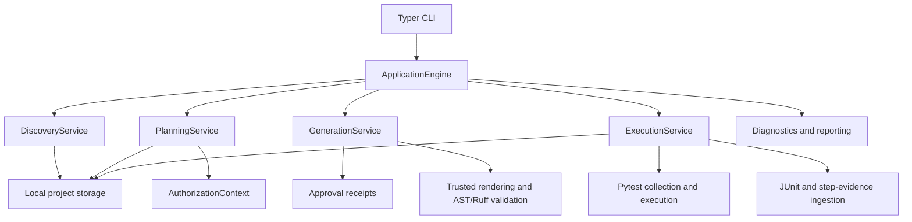

# AutoQA V0.3 final delivery

## Outcome

V0.3 Batch C is complete on the local `feat/v03-batch-c` branch. No push, merge or
pull request was performed. The implementation keeps the synchronous local engine,
generated Python Playwright/Pytest suites and V0.1/V0.2 artifact layout while adding
approval integrity, reusable execution services, step evidence and a shared application
entry point.

## Architecture map

`ApplicationEngine` and `InProcessAdapter` are reusable interface-independent
orchestration. Infrastructure remains behind the existing local storage, Playwright,
Pytest, JUnit and reporting adapters. No FastAPI, React or MCP dependency was added.

## Security hardening

New approvals write a separate `test-cases/approval-receipts.json` record containing a
schema, case ID, reviewed scenario signature, case revision, timestamp, source and
status. Generation validates that receipt against the current case before rendering.
New manifests mark `approval_binding: required`, and execution validates the same binding
again before starting a run. Changed, missing, malformed or invalid receipts fail closed;
reapproval creates a new receipt. AI remains advisory and cannot approve cases.

Legacy policy is explicit: an approved-but-not-yet-generated legacy case without a
receipt must be explicitly reapproved before new generation. Historical V0.1/V0.2
generated manifests remain readable and executable under their original manifest checks;
the runner does not fabricate receipts for them.

Guarantee: a newly generated suite cannot be created or run through these services unless
its current reviewed scenario is bound to a valid local approval receipt. Limit: local
receipts are not tamper-resistant against an attacker who can write both case and receipt
files. Authentication, cloud identity, authorization infrastructure and concurrent-writer
controls remain out of scope.

## Execution and evidence

`GenerationService`, `ExecutionService` and `JUnitIngestionService` provide reusable
services while `autoqa.testing` remains the compatibility facade. Generation continues to
produce ordinary Python Playwright/Pytest tests with manifest digests and approval
signatures. Collection failures, subprocess failures and missing JUnit records retain
their original statuses and exit codes.

Browser configuration now supports headless/headed mode, bounded `slow_mo_ms`, trace
enablement and screenshot policies: `every_step`, `failures_only` and `disabled`.
Generated runs emit structured step records with test ID, step ID, sequence, description,
status, timestamp, duration, error and evidence references. Assertion outcomes remain
separate from evidence-capture errors; sensitive assertion text is not copied into step
evidence logs. Historical runs continue to expose `NOT_RECORDED` step semantics rather
than invented history.

Focused evidence counts:

- Headless vertical slice: 4 passing scenarios, 4 traces, 0 screenshots under the
  `failures_only` default.
- Failure/report slice: 1 failed scenario, 1 trace and 1 failure screenshot.
- Headed slice: 1 passing scenario, 1 trace; real headed Chromium execution passed.

## Shared service interfaces

- `ApplicationEngine`: project-bound discovery, plan, approve, reject, generate, run,
  diagnose and report operations.
- `InProcessAdapter`: test/interface adapter exposing the same application operations.
- `DiscoveryService`: authorized browser, repository and hybrid discovery.
- `PlanningService`: authorized planning/review plus receipt-backed generation.
- `GenerationService`: approved rendering and validation.
- `ExecutionService`: collection, execution, run persistence and evidence ingestion.
- `JUnitIngestionService`: JUnit parsing without inventing missing outcomes.

All protected paths retain project-bound `AuthorizationContext` checks below interface
code. The CLI now delegates generation, execution, diagnostics and reporting through the
shared application/service layer and preserves existing options, generated-suite layout
and process exit codes.

## Verification

- Full non-browser regression: **175 passed, 13 browser cases deselected**; the added
  headed test is browser-only and was run separately.
- Owned local browser regression: **11 passed, 40 deselected**.
- Real headed Chromium execution: **1 passed**.
- Independent local acceptance workflow: **1 passed**, verifying the expected internal
  healthy 9-pass, regression 7-pass/2-fail, restored 9-pass sequence.
- Ruff check and format verification: passed.
- Package import verification: passed (`autoqa`, `autoqa.application`, `autoqa.engine`).
- No live AI calls, external websites or network benchmarks were used.

## Git commits

| Commit | Milestone |
| --- | --- |
| `4c9eace` | Stage 6.0 approval receipts and binding enforcement |
| `bf70190` | Stages 6.1/6.2 shared execution and step evidence |
| `119dfad` | Stage 7 shared application engine |

The branch was created from the verified Batch B HEAD `e55b824`; Stage 4 `d6e2614` and
Stage 5 `8e6dc67` are ancestors. This delivery document is the final local commit for
V0.3.

## Known limitations and V0.4 readiness

The local receipt record is an integrity binding, not a hostile-filesystem boundary.
Evidence is currently one generated scenario step around the trusted test body rather
than fine-grained instrumentation of every Playwright action. Sensitive-step metadata
needs richer domain-level sensitivity annotations before broad headed artifact sharing.
Storage remains single-writer. Browser evidence is potentially sensitive and requires
operator review before distribution. The package version remains the existing compatible
`0.2.0` metadata value pending an explicit release-version decision.

V0.3 is ready for V0.4 work on richer typed step contracts, authenticated interface
adapters, concurrency/revision control and finer-grained evidence policies. FastAPI,
React, MCP and cloud identity should remain future interface concerns rather than being
introduced as part of this local engine release.
